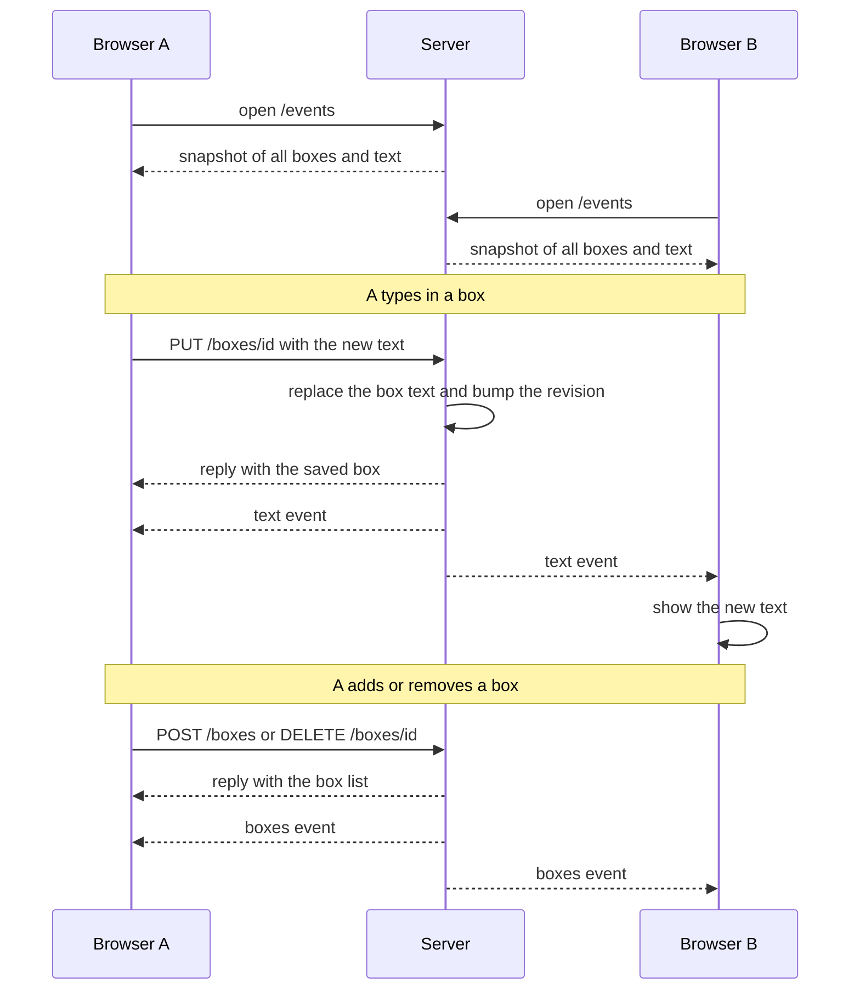

# Pastebin

A tiny shared text box for moving text between browsers. Paste in one tab and
it shows up in every other connected tab right away.

Live at <https://pastebin.atick.dev>.

> **Public by design.** There are no accounts and no passwords. Anyone who opens
> the page can read and change every box. Do not paste secrets. Text lives only
> in the server's memory, so a restart or redeploy wipes it.

## What it does

- Several text boxes, each with a **Copy** button. Add and remove boxes freely.
- Changes reach other connected browsers in a fraction of a second.
- New and reconnected browsers get the current text.
- The last update the server receives for a box wins. Concurrent edits are not
  merged.
- Keyboard shortcuts: `Alt+N` add, `Alt+1-9` focus, `Alt+C` copy,
  `Alt+Backspace` remove.

Go backend, plain HTML with a little JavaScript, and Server-Sent Events for
live updates. No database.

## How it works

The server keeps every box in memory and is the single source of truth. Each
browser opens one live stream (`/events`) and receives the current state on
connect. When you type, the browser sends the new text to the server, which
replaces the box and pushes the result to every connected browser.

Here is what happens when a browser connects, when you type, and when you add
or remove a box:



If a browser loses its connection, it reconnects and receives a fresh snapshot.
The server's state wins, so edits that were never sent are discarded.

## Run it

You need [Go](https://go.dev/dl/) (the version in `go.mod`).

```sh
go run ./cmd/pastebin            # http://localhost:8080
go run ./cmd/pastebin -addr :9000
```

Or with Docker:

```sh
just docker-run
```

## Develop

Run `just verify` before you push. It runs the same checks as CI. See
[AGENTS.md](AGENTS.md) for every `just` recipe.

Deploying to a VPS with Dokploy is covered in [docs/deploy.md](docs/deploy.md).
Contributions are welcome; read [CONTRIBUTING.md](CONTRIBUTING.md) first.

## License

Copyright 2026 Atick Faisal. Licensed under the [Apache License, Version 2.0](LICENSE).
